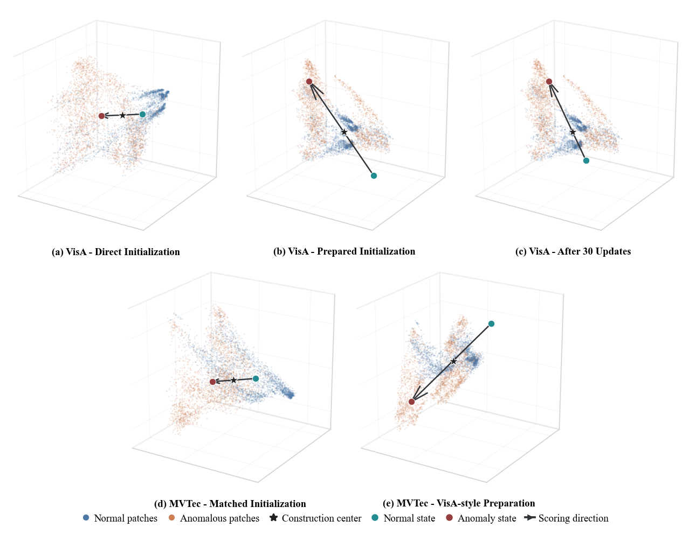

# CESAD

**Compact Experience States for Strict Cross-Dataset Zero-Shot Anomaly Detection**

CESAD learns a two-state anomaly scorer over frozen visual features.
Normal-tail regularization (NTR) supervises high-response normal patches, and
local re-observation (LRP) combines global and local anomaly evidence.



## Repository Structure

```text
cesad/
|-- cesad/          # CES heads, source transforms, training and inference
|-- configs/        # MVTec-source and VisA-source configuration templates
|-- tools/          # Source preparation and consistency checks
|-- tests/          # Head, loss, transform and evaluator tests
|-- assets/         # Figure used in this README
|-- research/       # Original experiment implementations and dependencies
|-- train.py        # Final CES-head training
|-- inference.py    # Frozen target inference
|-- evaluate.py     # Evaluation of saved predictions
`-- requirements.txt
```

The top-level entry points provide a separated interface. Original experiment
scripts remain under `research/` with their original relative imports.

## Environment

The local environment uses Python 3.13.5, PyTorch 2.9.1+cu130 and torchvision
0.24.1+cu130. Install a matching PyTorch build for your hardware.

```bash
git clone https://github.com/htsjp/cesad.git
cd cesad
python -m pip install -r requirements.txt
```

## Configuration

Set the local input and output paths in `configs/` before running. The provided
YAML files are templates, not bundled datasets or model files.

| Auxiliary source | Target datasets |
|---|---|
| Full MVTec AD | VisA |
| Full VisA | MVTec AD, BTAD, MPDD, DTD-Synthetic, DAGM 2007 |

## Source Preparation

The source preparation stage produces the features and fixed initialization
used by final-head training. The original source-build input checks are retained.

```bash
python tools/source_preparation.py --help
python tools/source_preparation.py --project-root /path/to/source/project --task preflight
```

Original preparation scripts retain their local manifest and approval bindings;
relocating the repository does not bypass these checks.

## Training

Train the final CES direction from prepared source features, labels and the
fixed batch plan. The center, scale and source transform remain frozen.

```bash
python train.py --config configs/train_visa.yaml --output outputs/train_visa --dry-run
python train.py --config configs/train_visa.yaml --output outputs/train_visa --device cuda
```

For MVTec-source training, use `configs/train_mvtec.yaml`.

## Inference

```bash
python inference.py --config configs/inference_visa.yaml --output outputs/visa_source --dry-run
python inference.py --config configs/inference_visa.yaml --output outputs/visa_source --device cuda
```

For MVTec-to-VisA, use `configs/inference_mvtec.yaml`. Inference saves raw
74 x 74 anomaly logits and a prediction manifest. LRP uses one global view and
four non-overlapping local views with fixed 0.5/0.5 fusion.

## Evaluation

```bash
python evaluate.py --manifest outputs/visa_source/manifest.csv --output outputs/visa_source_metrics
```

The evaluator reports I-AUROC, I-AP, P-AUROC, P-AP, P-F1max and AUPRO.
Pixel metrics use original-resolution paired masks and category-macro
aggregation. Image scores use the top-1% mean on the 74 x 74 score grid.

## Tests

```bash
python -m unittest discover -s tests -v
```

The organized interface has passed 11 unit tests and saved-source-asset parity
checks. Full training and benchmark reproduction were not rerun during this
repository reorganization.

## Acknowledgments

The visual implementation builds on CLIP, AnomalyCLIP-style components and the
MRAD-based research workspace. Inherited visual modules are not CESAD
contributions. Original third-party notices and licenses are retained; see
[Third-party notices](THIRD_PARTY_NOTICES.md).
